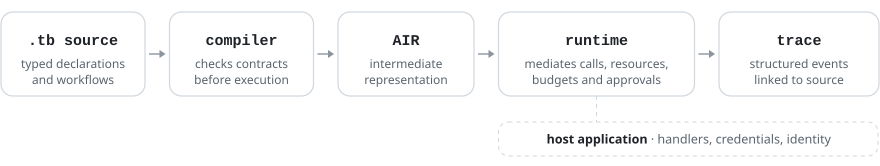

<div align="center">


<h1>Touba</h1>

<p><strong>A programming language and runtime for governed agentic systems.</strong></p>

<p>
  <picture>
    <source media="(max-width: 600px) and (prefers-color-scheme: dark)" srcset="assets/readme/acronym-dark-narrow.svg">
    <source media="(max-width: 600px)" srcset="assets/readme/acronym-light-narrow.svg">
    <source media="(prefers-color-scheme: dark)" srcset="assets/readme/acronym-dark.svg">
    
  </picture>
</p>

[](https://github.com/touba-labs/touba/actions/workflows/source-ci.yml)
[](https://toubalang.org/hub/telechargements/)
[](LICENSE)
[](https://toubalang.org/docs/demarrer/installation)

<a href="https://toubalang.org/">Documentation</a> &nbsp;·&nbsp;
<a href="https://toubalang.org/en/docs/">English docs</a> &nbsp;·&nbsp;
<a href="https://toubalang.org/hub/telechargements/">Downloads</a> &nbsp;·&nbsp;
<a href="https://toubalang.org/docs/tutoriels/">Tutorials</a> &nbsp;·&nbsp;
<a href="https://toubalang.org/benchmarks/">Benchmarks</a> &nbsp;·&nbsp;
<a href="https://toubalang.org/recherche/">Research</a>

</div>

<br>

An agent's instructions describe what it **should** do. Touba also makes
explicit what it **may** do: which capabilities it can invoke, which resources
those capabilities require, and where execution must wait for a human decision.

Programs use the `.tb` extension and compile to **AIR**, the intermediate
representation executed by the runtime.

<p align="center">
  <picture>
    <source media="(max-width: 600px) and (prefers-color-scheme: dark)" srcset="assets/readme/cli-demo-dark-narrow.svg">
    <source media="(max-width: 600px)" srcset="assets/readme/cli-demo-light-narrow.svg">
    <source media="(prefers-color-scheme: dark)" srcset="assets/readme/cli-demo-dark.svg">
    
  </picture>
</p>

## Touba at a glance

<p align="center">
  <picture>
    <source media="(max-width: 600px) and (prefers-color-scheme: dark)" srcset="assets/readme/governed-agent-dark-narrow.svg">
    <source media="(max-width: 600px)" srcset="assets/readme/governed-agent-light-narrow.svg">
    <source media="(prefers-color-scheme: dark)" srcset="assets/readme/governed-agent-dark.svg">
    
  </picture>
</p>

<details>
<summary><b>Copy <code>refunds.tb</code> and try the refusal</b></summary>

<!-- touba-example: compile -->
```touba
module shop.refunds

tool IssueRefund
    description "Refund an order through the payment API."
    takes order as Text
    gives Text
    requires network, secret_read
    secrets PAYMENTS_API_KEY

agent RefundAgent
    description "Refund the order and return the receipt."
    takes order as Text
    gives Text
    responsibility "Refund only the supplied order."
    uses IssueRefund
    callable_by strategy HandleRefund

strategy HandleRefund
    takes order as Text
    gives Text
    uses RefundAgent
    do
        human.approve
            with context as order
            with role as "finance"
            into approval
        RefundAgent
            with order as order
            into receipt
        give receipt
```


Append this strategy, which is not listed in `callable_by`, and the build fails
before anything runs:

<!-- touba-example: fragment -->
```touba
strategy RefundEverything
    takes order as Text
    uses RefundAgent
    do
        RefundAgent
            with order as order
```

</details>

## What you can build

- Typed tools and skills for business operations.
- Agents that choose among declared capabilities, with explicit caller rules.
- Multi-agent workflows and bounded parallel execution.
- Human approval steps with host-attested identity and role requirements.
- Resource-aware execution with secrets, scoped memory and declared budgets.
- Reusable packages containing declarations, handlers or contextual procedures.
- JavaScript and Python applications that run Touba and consume its events.

## How it works

<p align="center">
  <picture>
    <source media="(max-width: 600px) and (prefers-color-scheme: dark)" srcset="assets/readme/pipeline-dark-narrow.svg">
    <source media="(max-width: 600px)" srcset="assets/readme/pipeline-light-narrow.svg">
    <source media="(prefers-color-scheme: dark)" srcset="assets/readme/pipeline-dark.svg">
    
  </picture>
</p>

The compiler checks source contracts. During execution, the runtime mediates
calls, resource access, budgets and approval gates and produces structured
traces that connect each observed action or refusal to its source declaration.

> [!NOTE]
> The host remains responsible for credentials, identity and the behavior of
> external systems. These controls bound execution; they do not guarantee the
> correctness of a model's answer.

## Get started

Download Touba from the [downloads page](https://toubalang.org/hub/telechargements/).
The [installation guide](https://toubalang.org/docs/demarrer/installation)
covers archives, graphical installers and checksum verification for macOS
Apple Silicon, macOS Intel, Linux x64 and Windows x64.

```sh
touba version          # installed version and build
touba doctor           # check the local installation
touba update --check   # look for an available update
```

Create `hello.tb`:

<!-- touba-example: compile -->
```touba
module examples.hello

strategy Hello
    do
        show
            with message as "Touba ready"
```

With Touba 1.5.0, you can run the source file directly.

```sh
touba run hello.tb
# Touba ready
```

Use the commands below with Touba 1.4.0 or whenever you want to keep the compiled AIR for inspection.

```sh
touba compile hello.tb --out hello.air.json
touba run hello.air.json
touba run hello.air.json --output trace          # stream the execution events
touba run hello.air.json --trace-out trace.json  # or export them
touba inspect trace.json                         # and summarize the run
```

Scaffold a project with generated handlers, in the host language of your choice:

```sh
touba init --language javascript --root my-project
touba init --language python --root my-python-project
```

Install a host SDK from your application's directory with
`touba sdk install javascript` or `touba sdk install python`. The SDKs ship
with the toolchain, so there is no unpublished package to find on npm or PyPI.
Both use Touba's runtime and governance contracts.

## Explore a project

`touba explore` opens a read-only view of a project, compiled locally from its
sources: the architecture, each contract, the flow of a strategy with its
approvals, and the declared governance. No model or external service is needed.

<p align="center">
  <picture>
    <source media="(max-width: 600px) and (prefers-color-scheme: dark)" srcset="assets/readme/explore-dark-narrow.svg">
    <source media="(max-width: 600px)" srcset="assets/readme/explore-light-narrow.svg">
    <source media="(prefers-color-scheme: dark)" srcset="assets/readme/explore-dark.svg">
    
  </picture>
</p>

```sh
touba explore my-project
```

The [Explorer tutorial](docs/tutoriels/explorer-un-projet.md) shows how to build
the example above. In VS Code, **Touba: Explore Project** opens the same views.

## Core concepts

| Construct | Role |
| --- | --- |
| `tool` | A typed operation implemented by a host handler. |
| `skill` | A reusable composition of declared capabilities. |
| `agent` | A declared responsibility and capability-selection boundary. |
| `strategy` | An executable workflow. |
| `trigger` | A schedule or an HTTP request that starts a governed run. |
| Package | A versioned unit of reuse, with one `touba.package.json` manifest. |

Strategies and skills can also execute directly. Traces preserve the actual
structural caller instead of attributing those operations to an invented agent.

The [documentation index](docs/README.md) links guides in this checkout and
published editions in English and French. The [concepts](https://toubalang.org/docs/concepts/composants-touba),
[documentation](https://toubalang.org/docs/) and
[tutorials](https://toubalang.org/docs/tutoriels/) explain the language,
handler integration, multi-agent composition, parallelism and execution history.

## Reusable packages

```sh
touba package new review --org acme --license Apache-2.0 --yes
cd review
touba package check --publishing
touba package test
touba package pack
```

A package can contain executable declarations, contextual procedures, or both.
Consumers install an archive, a reviewed local directory, or an exact version
from an explicitly selected registry. The installer checks identity,
compatibility and content before updating the managed `packages/` directory.
It does not run author tests or install hooks.

> [!IMPORTANT]
> Installation does not grant runtime authority. The consuming program still
> declares its callers, bindings and permissions.

<details>
<summary><b>Testing, updating and auditing packages</b></summary>
<br>

`package test` starts from a fresh temporary distribution. The generated test
uses a separate consumer project for each case and leaves the author folder
unchanged. Tests still execute host code: review them before running.

To update an installed package, use `touba package update <archive-or-name@version>`
to preview its exact content, then `--accept <review_digest>` after review.
Changed project or package bytes require a new review. Run `touba prepare --mode plan`
afterward to review application contracts and permissions.
An explicit `--allow-downgrade` review can select an older version while retaining
consumer approval policies. It does not undo prior effects or data migrations.

`touba package audit` explicitly consults a configured registry for the status
of installed versions. It reports withdrawals and unknown versions without
changing installed packages or stopping executions. It is not a vulnerability scanner.
After a successful signed lookup, `audit --offline` or `list --status` reads
the verified cache without network access and makes its age and expiry visible.
Expired status evidence never authorizes installation.

</details>

See the [package guide](docs/guides/creer-partager-package.md) and the
[complete author-to-consumer tutorial](docs/tutoriels/package-reutilisable.md).

## Integration and observability

JavaScript and Python SDKs provide host integration and typed tool handlers.
Explicit MCP snapshots and REST/OpenAPI descriptions can generate reviewable
Touba contracts and handlers. Existing application code can be called through
those handlers; it does not become trusted merely by being imported.

The project server exposes HTTP and event-stream interfaces for host
applications. Those applications supply their identity and access policy.
AIR inspection, execution traces and audit commands help connect an observed
action or refusal to its source declaration.

## Research and evaluation

Touba implements **Probabilistic Agentic Programming (PAP)**. The paradigm's
responsibility-boundary principles are distinct from Touba's syntax and runtime
implementation.

The [benchmark page](https://toubalang.org/benchmarks/) presents the current
multi-provider interface study, including business outcomes and governance
evidence. Deterministic invariant tests are reported separately from model
performance. The [research page](https://toubalang.org/recherche/) links the
manuscripts and explains the scope of their formal results.

## Building from source

Requires Node.js 24.22.3 or a newer patched 24.x release, pnpm 10.33.2 and the
Rust toolchain pinned in `implementation/rust-toolchain.toml`. Use Python 3.11
or newer with `venv` and `pip` for SDK builds and Python validation.

```sh
cd implementation
pnpm install --frozen-lockfile
cargo build --locked -p touba-cli --bin touba-compile
cargo test --locked
python3 -m venv .venv-sdk-build
.venv-sdk-build/bin/python -m pip install -r runtime/touba-python-sdk/build-requirements.txt
TOUBA_PYTHON_BUILD_BIN="$PWD/.venv-sdk-build/bin/python" pnpm validate:v1-local
```

> [!TIP]
> On Windows, use `.venv-sdk-build/Scripts/python.exe` for the builder.
> `TOUBA_PYTHON_BUILD_BIN` selects that interpreter without changing your
> application environment. Set `TOUBA_TEST_PYTHON` to the same interpreter if
> the runtime tests would otherwise select an older Python from your PATH.

Installed-toolchain recipe checks are run separately against a packaged
release; the source checks use the compiler built above. Source checks do not
by themselves qualify a downloadable release. Platform installation checks
apply to the actual archives. Release maintenance is described in the
[version and release reference](https://toubalang.org/docs/reference/versions-releases),
and the contributor workflow in [DEVELOPMENT.md](DEVELOPMENT.md).

## Community

- **Contributing.** Read [CONTRIBUTING.md](CONTRIBUTING.md) before proposing a change.
- **Feedback.** Open a GitHub issue as described in [FEEDBACK.md](FEEDBACK.md), or write to
  [contact@touba-labs.com](mailto:contact@touba-labs.com) for access-independent feedback.
- **Security.** Report vulnerabilities as described in [SECURITY.md](SECURITY.md), never in a public issue.
- **Conduct.** Participation follows the [code of conduct](CODE_OF_CONDUCT.md).
- **Changes.** Public changes are summarized in the [changelog](CHANGELOG.md).

## Authors and citation

Touba is authored by Khadim Lo, Soukaina Alaoui Ismaili and Jean-Sébastien
Dessureault. See [AUTHORS.md](AUTHORS.md). To cite Touba, use **Cite this
repository** on GitHub, generated from [CITATION.cff](CITATION.cff).

## License

The Touba language implementation, runtime, CLI and SDK code in this repository
are open-source software under the [Apache License 2.0](LICENSE).
Third-party dependencies retain their respective licenses.

<br>

<div align="center">
<sub>Touba is developed by Touba Labs &nbsp;·&nbsp; <a href="https://toubalang.org/">toubalang.org</a></sub>
</div>
