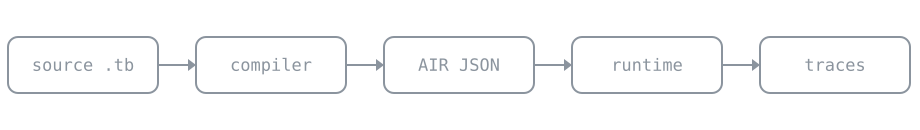

# Touba

Touba is a programming language and runtime for governed agentic systems.
Touba means `Thinking Orchestration Using Bounded Agency`, and the official
source extension is `.tb`.

In Touba, agents, tools, skills, memories, secrets and human validation are
language constructs with typed contracts, not conventions buried in prompts or
framework code. Programs compile to AIR, an explicit intermediate
representation, and the runtime executes AIR only: invocation authority,
grants, secret handles, budgets and payload limits are checked before any
external effect, and every run can produce structured traces that link back to
AIR nodes and source locations.

Touba is built for teams that need agentic autonomy and accountability at the
same time. It brings **Agents as Code** to agentic systems: developers declare
what a system can do, reviewers see who is allowed to invoke it, and operators
get observable refusals instead of silent failures. It is the executable path
of the PAP research program (`Probabilistic Agentic Programming`).

Documentation: https://pap-touba.github.io/documentation-site/

Benchmarks: https://pap-touba.github.io/documentation-site/benchmarks/

Benchmark evidence separates five-run live-model comparisons from structural
runtime/CLI checks for traces, triggers, memory provenance, budgets,
supply-chain drift, cancellation and multi-team authority.

Release history: [`CHANGELOG.md`](CHANGELOG.md)

## Why Touba

Touba gives agentic software an explicit programming model. It separates what a
system can do from who is allowed to invoke it, under which policies, with which
budgets, memories, tools, traces and review gates.

The core model is:

- `tool`: a bounded external action;
- `skill`: a typed composition of capabilities;
- `agent`: the responsibility and invocation authority attached to execution.

This distinction makes agentic behavior easier to analyze, test, govern and
operate than prompt-only orchestration.

## Research Mission

Touba is built to produce resources that can be evaluated and reused in
industrial contexts, but its primary purpose is research: understanding the
technical, organizational and societal challenges raised by agentic AI, then
developing programming models, tools and evidence that respond to them.

Researchers, developers, practitioners and institutions working toward
responsible, safe, secure, transparent and inclusive AI are invited to
contribute to this effort through code, documentation, examples, reviews,
evaluations, criticism, educational material or deployment feedback.

## Agents as Code

Touba treats agent authority as code. Source `.tb` files, AIR, manifests, run
plans, locks, traces and review gates are artifacts that teams can commit,
diff, review, validate and audit before execution.

The analogy with Infrastructure as Code is intentional: a team should not let
agents act from unreviewed prompts any more than it would let production
infrastructure be changed by hand. Touba makes tool access, invocation
authority, budgets, payload boundaries and execution evidence explicit.

The distribution roadmap continues through signed installers, package managers,
hosted operation layers and registry services. The V1 core focuses on the
language, runtime, CLI, traces, packages and release archives that make governed
agent execution concrete.

## Quick Start

Install Touba from [Touba Hub](https://pap-touba.github.io/documentation-site/hub/) or
from the [GitHub Releases](https://github.com/pap-touba/touba/releases/tag/v0.1.0)
page. Release archives are available for macOS Apple Silicon, macOS Intel,
Linux x64 and Windows x64.

Follow the
[installation guide](https://pap-touba.github.io/documentation-site/docs/demarrer/installation)
for browser downloads, terminal downloads, checksum verification and platform
commands. After installation, check the CLI:

```sh
touba version --json
touba doctor --json
```

Create `hello.tb`:

```text
module examples.hello

strategy Hello
    do
        show
            with message as "Touba ready"
```

Compile and run:

```sh
touba compile hello.tb --out hello.air.json
touba run hello.air.json
```

The run prints `Touba ready`. Add `--output trace` to see the structured
execution trace of the same run.

## Installation And Updates

The primary installation surface is Touba Hub:
https://pap-touba.github.io/documentation-site/hub/

The CLI archives are published as GitHub Release assets:

| Platform | Archive |
| --- | --- |
| macOS Apple Silicon | `touba-v0.1.0-darwin-arm64.tar.gz` |
| macOS Intel | `touba-v0.1.0-darwin-x64.tar.gz` |
| Linux x64 | `touba-v0.1.0-linux-x64.tar.gz` |
| Windows x64 | `touba-v0.1.0-win32-x64.tar.gz` |

`touba update` is an update-policy command in V1. It reports the installed
version, channel, platform, Hub URL, expected archive and reinstall commands.
It does not perform automatic replacement; reinstall from a newer archive or
from the package manager channel that installed Touba.

## Example

A minimal governed composition with `tool`, `skill`, `agent` and `callable_by`:

```text
module examples.agent_simple

type DatasetRequest
    query is Text

type DatasetBrief
    summary is Text

tool SearchDatasets
    description "Search approved dataset sources for records matching the request."
    takes request as DatasetRequest
    gives DatasetBrief
    requires network

skill BuildDatasetBrief
    description "Build a governed dataset brief from approved search results."
    takes request as DatasetRequest
    gives DatasetBrief
    uses SearchDatasets
    do
        SearchDatasets
            with request as request
            into result
        give result

agent Researcher
    description "Research agent that selects authorized dataset-brief capabilities."
    responsibility "Select the declared research capability that matches the request."
    uses BuildDatasetBrief
    callable_by strategy RunDatasetResearch

strategy RunDatasetResearch
    uses Researcher
    do
        Researcher
```

The `tool` declares a bounded external action, the `skill` composes it into a
typed capability, the `agent` carries the responsibility for selecting what to
execute, and `callable_by` declares who is allowed to invoke that agent.
Capabilities exposed through `agent.uses` must carry source descriptions so
decision providers receive stable semantic contracts. The runtime refuses
anything outside these declarations before any external effect.

## Architecture

<p align="center">
 
</p>

- the compiler turns `.tb` sources into AIR, an explicit intermediate
 representation of every executable node;
- the runtime executes AIR only: callers, grants, secrets, budgets and payload
 limits are checked before any external effect;
- every run can emit structured trace events that reference AIR nodes and
 source locations.

Nothing executes outside this pipeline: no hidden prompt orchestration and no
implicit tool discovery.

## Repository Scope

This repository contains the Touba language and runtime core:

- language specifications;
- parser, AST and AIR generation;
- runtime and trace contracts;
- command-line tools;
- SDK and handler contracts;
- examples, fixtures and validation tests.

## Building From Source

Prerequisites:

- Node `>=24 <25`;
- pnpm `10.33.2`;
- Rust `1.95.0`, pinned by `implementation/rust-toolchain.toml`.

```sh
cd implementation
pnpm install
cargo test -p touba-compiler
pnpm validate:v1-local
```

`pnpm validate:v1-local` aggregates the runtime, CLI, project, SDK, corpus and
fixture validations used to qualify a local build.

## Source CI

The repository includes a source-build workflow for pull requests, pushes to
`main` and manual runs. The workflow validates the source tree and can produce
release archives for supported platforms. Public downloads are published
through GitHub Releases and surfaced in Touba Hub; Actions artifacts are for
build inspection.

The matrix is:

| Target | Runner | Suite |
| --- | --- | --- |
| Linux x64 | `ubuntu-24.04` | full source validation |
| macOS Intel | `macos-15-intel` | core build/runtime/CLI validation |
| macOS Apple Silicon | `macos-14` | core build/runtime/CLI validation |
| Windows x64 | `windows-2025` | core build/runtime/CLI validation |

Linux carries the heavier corpus and local toolchain smoke checks to keep macOS
minutes controlled. All jobs run release metadata tests and can upload a
platform release archive with `SHA256SUMS`, `CHECKSUMS.json` and generated
release notes for manual publication.

## Local Release Packaging

The source tree can produce a local release bundle for the current host
platform:

```sh
cd implementation
pnpm package:touba-release
pnpm test:distribution-release
pnpm check:touba-release-macos
```

`package:touba-release` refuses cross-platform packaging by default. Platforms
without a validated release profile must be generated explicitly as
experimental artifacts and remain non-public until their OS validation gates
pass.

## Static Registry Resolution

Touba can resolve static registry metadata into a local lock without installing
or executing package content:

```sh
touba registry resolve \
  --registry ../touba-registry \
  --package pkg:touba-library/donnees-quebec-dataset-brief \
  --version 0.1.0 \
  --source-root ../touba-library \
  --allow-draft \
  --out donnees-quebec.lock.json
```

The command verifies the registry index, package metadata digest, requested
version, protocol compatibility and status. When `--source-root` is provided,
it also verifies source artifact digests. It does not provide a hosted registry
service, package installation, signature verification or runtime authority.

## MCP Import

Existing MCP tools can be brought under Touba contracts through an explicit
tools snapshot:

```sh
touba mcp import mcp.github.json \
  --module integrations.mcp.github \
  --out integrations/github \
  --mode plan
```

The importer generates reviewable `.tb` source, a manifest fragment, bridge
handlers, `mcp.bridge.config.json`, a secrets template and an import report.
`plan`, `write` and `check` modes make the generated contract diffable before
the bridge is connected to an approved local MCP `stdio` server.

## REST/OpenAPI Scaffold

HTTP APIs can be scaffolded into Touba contracts from an explicit operation or
a simple OpenAPI `operationId`:

```sh
touba rest scaffold rest.search.json \
  --module integrations.web_search \
  --out integrations/web-search \
  --mode plan
```

The scaffold generates reviewable `.tb` source, a manifest fragment,
`rest.handler.config.json`, a bounded HTTP handler, a secrets template and a
generation report. `write` materializes the files, while `check` verifies that
generated artifacts stay aligned with the input configuration.

## Agent Decision Providers

`touba run` can delegate an agent's capability choice to an explicit decision
provider while keeping runtime authority in Touba:

```sh
touba run program.air.json \
  --agent-decision-provider providers/researcher.provider.mjs \
  --agent-decision-provider-content-mode opaque_refs
```

The default content mode is `inline`. `opaque_refs` replaces raw runtime inputs
and observations in the provider request with references and metadata, then
records the mode in the trace. The runtime still revalidates selected
capabilities, arguments, budgets and `callable_by` before execution. This mode
does not install a provider, grant hidden authority or make a third-party model
trusted by default.

## Platform Support

| Platform | Status | Artifact |
| --- | --- | --- |
| macOS Apple Silicon | Release archive published | `touba-v0.1.0-darwin-arm64.tar.gz` |
| macOS Intel | Release archive published | `touba-v0.1.0-darwin-x64.tar.gz` |
| Linux x64 | Release archive published | `touba-v0.1.0-linux-x64.tar.gz` |
| Windows x64 | Release archive published | `touba-v0.1.0-win32-x64.tar.gz` |
| VS Code extension | VSIX published from `touba-ide` | `touba-vscode-0.1.0.vsix` |

Downloads are available through Touba Hub and GitHub Releases. Signed
installers, package-manager channels and marketplace publication are the next
distribution layers.

## Use This Repository For

- understanding the Touba language model;
- following the AIR, runtime and trace contracts;
- working on the compiler, CLI, SDK and handler interfaces;
- validating examples, fixtures and governed execution behavior;
- connecting editor, documentation, Touba Library and registry work to the
 language core.

## Origins

Touba grew out of the PAP research program. The public research overview and
the citation reference are maintained in the official documentation:
https://pap-touba.github.io/documentation-site/recherche/

## Contributing And Feedback

Contributions, bug reports, proposals and documentation feedback are handled
through GitHub Issues and pull requests.

Read `CONTRIBUTING.md`, `FEEDBACK.md`, `SECURITY.md` and
`CODE_OF_CONDUCT.md` before opening a change.

## How To Cite

```bibtex
@software{touba2026,
  author  = {Lo, Khadim and Dessureault, Jean-S{\'e}bastien and Alaoui Ismaili, Soukaina},
  title   = {Touba: A Programming Language and Runtime for Governed Agentic Systems},
  year    = {2026},
  url     = {https://github.com/pap-touba/touba},
  version = {0.1.0}
}
```

GitHub also renders this metadata from `CITATION.cff` through the
`Cite this repository` button.

## Authors

Touba is authored by Khadim Lo, Professor Jean-Sebastien Dessureault and Soukaina Alaoui Ismaili. Khadim Lo is the principal maintainer; Jean-Sebastien Dessureault is the research supervisor. See `AUTHORS.md` for roles and contact addresses.

## License

This repository is licensed under the Apache License 2.0. See `LICENSE`.
